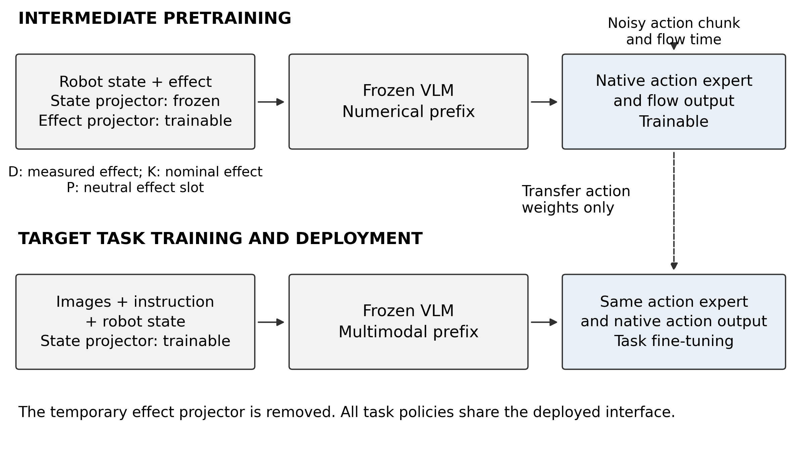

# Historical version 1: superseded where specified

This preserves the 20 November 2026 initial design. Read ../research/STAGE1_SCOPE_AND_CLAIMS.md and ../research/PRELIMINARY_PROTOCOL.md for current instructions. This archive does not authorize execution. In particular, its eight-coordinate effect token, mandatory shift/probe study, single primary contrast and preliminary program have been superseded.

# Sensorimotor pretraining for vision language action policies

RSS 2027 research design and experimental plan

20 November 2026

## 1 Research decision

The project is worth developing as a controlled study of what transfers from numerical sensorimotor pretraining into a vision-language-action policy. Its strongest question is whether measured action effects add useful supervision beyond learning the distribution of robot actions and the nominal mapping between commands and motion.

The proposed paper title is **Do Measured Action Effects Improve Pretraining for Vision-Language-Action Policies?** A more neutral alternative is **What Transfers from Sensorimotor Pretraining to Vision-Language-Action Policies?**

The original proposal contributes a useful constraint: intermediate training should use numerical robot trajectories, and its benefit should survive through the existing action-generation weights without adding a deployed physical module. The scientific contribution should be the controlled test of that constraint. Task-free pretraining, image-free action pretraining, and predictive sensorimotor learning already have close precedents [6-8].

The design below fixes a primary method, competing explanations, controls, outcomes and interpretation rules. It specifies a finite Stage 2 study and a smaller preliminary sequence. Empirical performance, attainable precision and execution time remain to be measured. No empirical result or acceptance probability is claimed.

### Intended contributions

1. A controlled comparison that estimates the additional value of measured action effects over a motion prior and a nominal command-effect relation, using the same interaction data and deployed VLA.
2. An explicit transfer procedure that adapts the native flow-matching action generator while removing temporary effect conditioning before target-task training.
3. An analysis of acquisition, accessibility after fine-tuning and downstream usefulness, with interpretation rules that distinguish informative negative evidence from an unresolved experiment.

The first contribution carries the paper. The transfer procedure supplies a concrete intervention; it is not presented as the first use of inverse dynamics or action pretraining.

## 2 RSS 2027 requirements and positioning

The official process permits incomplete experiments at the initial deadline. It expects a developed technical formulation and methodology. Stage 1 has five content pages and one reference page; material outside that submission cannot establish the case [1,2]. The reviewer criteria are the value of the hypothesis and the feasibility of reaching a defensible conclusion [3].

| Milestone | Official date at 23:59 AoE |
| --- | --- |
| Initial submission | 4 December 2026 |
| Rejection or invitation to rebuttal | 5 February 2027 |
| Rebuttal | 12 February 2027 |
| Invitation to execute the Extension Charter or rejection | 26 February 2027 |
| Final paper | 16 April 2027 |
| Supplementary material | 19 April 2027 |
| Final acceptance decision | 30 April 2027 |

The initial deadline is 5 December at 12:59 in Paris. The final manuscript has an eight-page content limit, excluding references [1]. Passing the initial filter does not constitute final acceptance.

For this project, the five-page scientific case must establish why distinguishing measured effects from action priors matters, explain the actual parameter-transfer pathway, and show how the evaluation can discriminate the explanations. A useful negative result requires evidence that the tested construction learned something relevant and that the downstream comparison was informative. Reporting a lower success rate alone would not meet that scientific standard [2].

Anonymization, the official format and verified references are submission requirements [1]. Hardware validation, a theorem, public preregistration and a particular number of experiments are not listed as universal requirements in the reviewed instructions. Our protocol lock, uncertainty analysis and feasibility checks are methodological recommendations. The eventual Extension Charter can add or revise experiments.

## 3 Revision of the original proposal

| Original element | Revision and reason |
| --- | --- |
| Learn physics before learning tasks | Study intermediate pretraining before target-task fine-tuning. The proposed public checkpoint has already learned from robot demonstrations. |
| One-step state-difference regression as the main method | Use effect-conditioned action flow matching as the primary intervention, preserving the native action output. Keep forward regression as a defined diagnostic variant. |
| Standard VLA versus physically pretrained VLA | Include action-prior, nominal-effect and extra-task-training controls. Each addresses a separate explanation. |
| Joint or end-effector state treated as physical state | Call it observed proprioception and distinguish it from the complete simulator state. |
| Mass, friction, damping and delay treated alike | Audit sensitivity and task relevance. Separate object dynamics from actuation changes; defer delay because it creates additional history dependence. |
| Better probes counted as an alternative success | Use probes to interpret learning and transfer. Task improvement and representational accessibility are separate claims. |
| Several simulators and possible VLAs | Use one embodiment, one simulator family and one fixed VLA for the core study. |
| Benefits assumed to occur with scarce data or shifts | State these as testable hypotheses with predefined outcomes and uncertainty. |

The original forward objective is not inherently inappropriate. The concern is that predicting a state with a temporary head does not directly train the action output used during deployment. A comparison with the proposed inverse formulation would examine a package of changes, including conditioning and target information. It would not, by itself, isolate optimization geometry.

## 4 Related work and the remaining question

### Closest comparisons

| Work | Established contribution relevant here | Consequence for this study |
| --- | --- | --- |
| TAP, Shi et al., ICML 2026 [6] | Inverse-dynamics pretraining on task-free trajectories, using visual observations, before task alignment. | The motivation of learning movement before task semantics is established. Numerical inputs alone cannot carry the novelty. |
| AR-VLA, Hu et al., 2026 [7] | An autoregressive action expert with action-only pretraining and persistent temporal context. | Image-free action-expert pretraining is established. Include a motion-prior control within the same SmolVLA. |
| PSR, Li et al., 2026 [8] | Predictive sensorimotor pretraining and integration of a learned hierarchy into the policy action stream. | Predictive sensorimotor learning is established. Focus on transfer through existing weights and unchanged deployment. |
| SLIM-0.5B, Wang et al., 2026 [10] | Action-grounded predictive latents, action reconstruction and future prediction followed by flow-based policy training. | Combining predictive objectives and action generation is established. |
| Robots Pre-train Robots, Jiang et al., ICLR 2025 [9] | Visual representation pretraining informed by actions and proprioception. | Distinguish action-generator adaptation from visual-encoder pretraining. |
| Zhao et al., 2026 [11] | Controlled study of proprioceptive state interfaces and history. | Hold the primary interface fixed rather than introducing a new state architecture. |
| MoSS and HAMLET [12,13] | Additional physical-signal streams or temporal memory in VLAs. | Additional deployment information answers a different question from intermediate supervision alone. |

The defensible gap is a question: **Does measured action-effect correspondence provide useful initialization beyond matched action data and nominal controller inversion when the deployed architecture and observations are held fixed?** The reviewed sources motivate that distinction. They do not establish that the complete intersection is a first-ever result.

PSR's primary abstract was available, but its full paper could not be retrieved in this review. Its role above is restricted to what that abstract establishes. Verify its detailed transfer and ablation design before writing any stronger novelty claim.

RoboTwin-Phys already evaluates physical-condition diversity [14]. Therefore a new collection of mass and friction perturbations is not itself the proposed contribution. CLAP also discusses retention during fine-tuning [15]. Forgetting should be measured carefully without presenting it as a newly discovered general problem.

### Literature narrative for the initial paper

The related-work section can use three short paragraphs. First, explain task-free and action-only pretraining through TAP and AR-VLA. Second, explain predictive representations and added physical streams through PSR, SLIM and MoSS. Third, state the unanswered controlled comparison and connect state observability to the design. SmolVLA supplies the implementation reference. The broader state, memory and robustness literature belongs in the full paper.

### Corrections to the supplied bibliography

The titles examined are real, but several first-author initials in the proposal require correction. Robots Pre-train Robots is by Guangqi Jiang et al.; SLIM-0.5B is by Jingkai Wang et al.; MoSS is by Jimin Lee et al.; HAMLET is by Myungkyu Koo et al.; RoboTwin-Phys is by Jiaqi Zhang et al. SmolVLA is by Mustafa Shukor et al., and the proprioception study is by Yiren Zhao et al. Use publisher or author metadata when constructing the final bibliography [4,9-14].

## 5 Research questions and hypotheses

### RQ1 The value of measured effects

When action data, model initialization, retained parameters, optimizer schedule and downstream training are fixed, does conditioning intermediate pretraining on measured effects improve task success relative to conditioning on nominal commanded effects?

**H1 is the primary hypothesis.** At the low-demonstration budget, measured-effect pretraining improves mean nominal task success by at least five percentage points over the nominal-effect control. Five points is a proposed smallest effect of practical interest, chosen before results; it is not an expected result or an RSS requirement.

### RQ2 The conditions under which transfer matters

Does the measured-effect advantage depend on demonstration availability or on a physically meaningful shift?

**H2 is secondary.** The measured-effect advantage over nominal effects is larger at the low-demonstration budget than at the full budget. This is an interaction hypothesis. A significant comparison at one budget and a nonsignificant comparison at the other do not establish it.

**H3 is secondary and conditional on a valid intervention.** Under the first prespecified mechanical factor that passes the physical audit, the decrease in success from nominal to shifted conditions is smaller for measured-effect pretraining than for nominal-effect pretraining. Its single endpoint is the equally weighted average of the four shifted values and ten tasks, computed within each training replicate. Individual shifted values are descriptive. Absolute shifted success must also be reported, because a smaller decrease can arise from poor nominal performance.

### RQ3 Acquisition and retention

If downstream transfer is small or harmful, did the intermediate task fail to learn useful action-effect structure, did accessibility change during task fine-tuning, or did accessible structure fail to improve the tested decisions?

This is a diagnostic question with competing explanations. We do not assume that forgetting will occur, or that a probe can identify a unique causal mechanism. Probe results cannot substitute for H1.

### Estimand and claim hierarchy

For method m, training replicate s and task j, let p_hat(m,s,j) be the success fraction on the fixed nominal evaluation bank at the low-data budget. The primary difference is computed within each paired replicate, averaging the ten tasks equally.

$$
d_s=\frac{1}{10}\sum_{j=1}^{10}(\hat p_{D,s,j}-\hat p_{K,s,j}),\qquad \Delta=\frac{1}{n}\sum_{s=1}^{n}d_s
$$

The expectation is over the declared training and demonstration-sampling randomness, conditional on the fixed task suite, interaction corpus and evaluation reset bank. The ten tasks are not treated as a random sample of all manipulation. Broader inference over reset configurations is a separate sensitivity analysis.

H1 concerns measured effects versus nominal effects. Comparisons with the action prior, standard fine-tuning and extra task training establish different practical implications. A positive primary contrast with performance below standard fine-tuning would not establish a useful intervention.

## 6 Problem formulation and information boundaries

Let x_t be the complete simulator state and phi the episode's mechanical parameters. Let r_t be the robot observation available to the model, I_t the camera observations, l the instruction and a_t the executed action command. These symbols refer to different information. In particular, r_t is not assumed to make the process Markovian.

The deployed policy produces an action chunk A_t = (a_t, ..., a_(t+H-1)) from (I_t, l, r_t). The proposed intermediate corpus contains (r_t, A_t, r_(t+H)) and metadata needed for reproducibility. Image pixels, instructions, object poses, simulator parameters and task success labels are excluded from intermediate model inputs.

In the documented LIBERO interface, r_t has eight entries: end-effector translation, axis-angle orientation and two gripper joint positions. The action has seven entries: Cartesian position and orientation commands plus gripper control [16]. These are observations and controller commands, not joint torques or a full object-contact state.

Define p_t as end-effector position, R_t as its rotation matrix and g_t as the two gripper coordinates. The measured terminal effect uses relative rotation in the initial end-effector frame.

$$
e_t=\left[p_{t+H}-p_t,\ \mathrm{Log}(R_t^{\mathsf{T}}R_{t+H}),\ g_{t+H}-g_t\right]
$$

The relative-rotation logarithm avoids subtracting axis-angle coordinates. Its frame convention must agree with the nominal controller map and remain constant across phases.

The nominal effect is e_t^K = G(r_t, A_t), where G composes the pinned controller's command interpretation without using any realized future measurement. It must reproduce command scaling, clipping, translation and rotation frames, and gripper target semantics. It must not update its calculation from later observed robot poses, because that would leak physical outcomes into the nominal control.

The residual e_t - e_t^K describes deviations from this declared nominal map. It is a diagnostic quantity rather than a general measure of physical understanding.

### An observability limit

If two physical settings present the same inputs to a policy at a decision, the policy cannot select different actions solely because the hidden setting differs. Weight pretraining can supply a prior or a robust strategy, but cannot create an observation that is absent at deployment. Subsequent camera or proprioceptive observations may reveal differences; the limitation applies at decisions where the available inputs remain indistinguishable.

This elementary observation motivates the measurement audit. A physical perturbation can affect an object while hardly changing the robot's measured trajectory, especially under a feedback controller [17]. Sensitivity of the outcome to a parameter also does not imply that the parameter is identifiable from the current input.

## 7 Primary transfer method

### Native action generation

SmolVLA projects robot state into the vision-language prefix and uses a flow-matching action expert with a noisy action suffix [4,5]. The experiment retains this separation. The primary implementation is a small training wrapper around the native model rather than a new deployed architecture.

During intermediate training, the prefix contains the frozen native state token followed by one temporary effect token. The suffix contains the native noisy action chunk and time representation. Numerical tokens pass through the frozen language decoder; the vision encoder does not receive images in this phase.

The effect token summarizes one terminal effect. Providing every future proprioceptive frame would make it easier to reconstruct individual Cartesian commands directly, weakening the distinction between physical learning and nominal inversion.

### Training objective

Use the current implementation's convention in which tau = 1 is noise and tau = 0 is data. Sample flow times from the pinned native training distribution.

$$
X_\tau=(1-\tau)A_t+\tau\epsilon,\qquad \epsilon\sim\mathcal{N}(0,I)
$$

$$
\mathcal{L}_{\mathrm{FM}}=\mathbb{E}\!\left[\left\|v_\theta(X_\tau,\tau,r_t,e_t)-(\epsilon-A_t)\right\|_2^2\right]
$$

The conditional distribution can be multimodal: many action sequences can lead to the same endpoint. The model is not required to reconstruct a uniquely determined action.

For the measured-effect condition D, e_t is the measured terminal effect. For the nominal condition K, it is the output of G. For the action-prior condition P, the effect slot contains a fixed neutral value. All three use the same trajectories, target actions, prefix allocation, native suffix, noise draws and optimization schedule.

In D, K and P, mask the effect token out of attention on the same fixed 20% of samples. Merely setting its numerical content to zero is insufficient to reproduce absence of the token. State precedes effect, and the wrapper preserves the native attention semantics. Effect masking offers practice without effect conditioning; it does not remove the later change to a visual-language prefix.

### Parameters and transfer

| Component | Intermediate training | Target-task fine-tuning |
| --- | --- | --- |
| Vision-language backbone | Frozen | Frozen |
| Native state projector | Frozen | Trainable in every arm |
| Native action expert and action/time projections | Trainable | Trainable |
| Temporary effect projector | Trainable | Removed |
| Native action output projection | Trainable | Trainable |
| Auxiliary dynamics or physical module at deployment | None | None |

Freeze parameter updates without disabling the gradient path from the effect projector through the language decoder. Use the same checkpoint, feature shapes and output masking in all arms. Before task training, discard the temporary projector, transfer only the adapted native action-generation parameters, and reset optimizer and scheduler state.

The primary downstream policy receives exactly the same observations and has the same action horizon, flow integration schedule and replanning rule in every arm. Training the state projector during the intermediate stage is excluded so that retained changes can be localized to the action-generation path.

### Planned configuration

The starting configuration is H = 16 predicted actions, four executed actions before replanning, and ten flow integration steps. These are proposed settings, not a claim about default SmolVLA. Use the simulator's native control frequency and record its value. All arms share these settings.

Proposed optimization anchors are 5,000 intermediate updates with effective batch 128 and 10,000 task updates with effective batch 32. They define a profiling target, not an assertion that convergence or the available compute budget is sufficient. Before confirmatory training, one common development protocol must establish baseline viability and freeze final schedules. The primary D and K schedules cannot be tuned separately to improve their contrast.

Use one coordinate and scaling convention across phases. Prefer deterministic scaling from the controller's declared ranges. If the pinned implementation requires fitted normalization, fit it only on the permitted training data, record the transform and make the transfer conversion explicit. Statistics from validation or test trajectories are prohibited.

### Diagnostic variants

A shuffled-effect variant can permute terminal effects across different trajectories within coarse initial-pose and gripper bins. It tests reliance on correspondence, but can introduce contradictory conditioning and damage useful weights. It is not a sufficient primary baseline.

The original forward variant can predict effects over several horizons from current proprioception and action chunks using a temporary head. Its targets should include residuals relative to G and should be compared with persistence and a small raw-input predictor. This variant is prespecified for a bounded diagnostic, not included in the full primary factorial.

## 8 Data collection and physical audit

### One embodiment and one simulator family

Use the LIBERO robot and controller throughout collection, pretraining and target tasks. Do not collect in KinDER and silently transfer across robots or action conventions in the core study. Such a transfer would add embodiment, action and simulator differences to the question.

Use all ten LIBERO-Goal tasks as the fixed target suite: drawer opening, drawer-and-bowl placement, plate pushing, stove actuation, several bowl placements, cream-cheese placement and two wine-bottle placements [16]. The complete official task identifiers are preserved in the experiment manifest.

The proposed low and full budgets are 10 and 40 training demonstrations per task, with ten additional demonstrations reserved for validation when the selected original release supports a 50-trajectory split. This corresponds to 25% and 100% of the training pool. The data audit must verify actual counts before the manuscript claims these exact numbers. If filtering leaves fewer trajectories, freeze a common feasible count and state it explicitly. A middle budget is optional.

### Interaction corpus

Collect numerical interaction trajectories in separate reset states and object arrangements, using the same embodiment and action semantics. A starting corpus target is 250,000 transitions. This is a planning amount that can be revised using development coverage and compute measurements before the confirmatory lock.

Use bounded Cartesian excitation, smooth direction changes and gripper open-close primitives. Sample initial configurations that provide both free-space and contact transitions. The collector may use simulator geometry to construct valid resets; that information must be documented and withheld from model inputs. Do not condition collection on target task success, language labels or retained successful demonstrations.

Record failed actions and ordinary unsuccessful interactions. Exclude only prespecified invalid simulation states, numerical failures or actions outside declared bounds. A contact-enriched collector is not cost-free or entirely free of design knowledge; report the reset construction effort and the realized contact coverage.

Split by complete episode, reset configuration and object arrangement before extracting overlapping windows. All windows from a trajectory belong to one split. D, K and P use identical training rows, so differences in contact frequency or action coverage cannot explain their contrast. Keep development, probe and confirmatory evaluation banks separate.

### Physical perturbations

The candidate factors are robot joint damping, object-surface friction and manipulated-object mass. Treat them as separate factors. Mass changes require consistent inertia updates; friction changes require checking the effective contact parameters. A configuration edit alone does not establish that the intended physical intervention occurred.

A proposed grid uses multipliers 0.8, 1.0 and 1.2 during interaction collection. Independent development values are 0.9 and 1.1. Confirmatory shifted values are 0.85 and 1.15 within the training range, and 0.6 and 1.4 outside it. These numerical values are candidates subject to mechanical validity and solvability checks, not assertions of equal difficulty across factors. Fix any changes before downstream treatment outcomes are examined.

For each factor, replay matched complete simulator states and action chunks while varying only that factor. Restore or deterministically reconstruct controller targets and persistent controller state, gripper state, random-number state and initialization/warm-up behavior; restoring positions and velocities alone is insufficient. Measure robot effects, object displacement or slip, numerical stability and feasibility of the underlying task. Include repeated nominal replays to characterize numerical and observation variation.

Use the following eligibility rule. The intervention must change a task-relevant outcome, preserve physically valid solvable tasks, and produce measurable action-dependent signal relevant to the declared pretraining channel. Before replay analysis, record channel-specific resolution floors and task-relevant displacement or slip tolerances. As a provisional signal criterion, at least 20% of the development pairs must exceed five times the larger of the duplicate-replay variation and the declared channel resolution floor. This is an eligibility convention, not proof of identifiability. Estimate whether observed residuals can be predicted from the permitted inputs beyond a nominal or persistence model. If the inputs alias the changed physical settings, evaluate a distributional target or explicitly limit the claim to average behavior; do not assume hidden-parameter identification.

Joint damping has first priority for H3, followed by friction and then mass. Selection is based on this physical audit, not on which factor produces a favorable D-versus-K score. Report all candidate factors and reasons for exclusion. If none passes, the planned physical-transfer claim is not yet viable and must be revised before a large training campaign.

Action delay is excluded from the core. A delay experiment would require explicit action-history or actuator-queue handling in every relevant arm. It should be a separate agreed extension.

## 9 Comparators and matching

| Label | Training treatment | Main question answered |
| --- | --- | --- |
| S | Public checkpoint followed by ordinary task fine-tuning | Does the complete intervention improve the standard starting point? |
| P | Intermediate action flow training with no informative effect | Does it add beyond learning the play-action distribution? |
| K | Intermediate flow training conditioned on nominal commanded effects | Does measured outcome information add beyond command inversion? |
| D | Intermediate flow training conditioned on measured effects | Proposed treatment |
| E | Ordinary task training plus an equivalent additional compute allowance | Is intermediate training a useful allocation of the extra compute? |

D versus K is the primary scientific contrast. D versus P measures the value of effect conditioning more broadly. D versus S tests practical improvement. D versus E tests the resource-allocation claim using the same permitted demonstrations.

Match D, K and P on corpus rows, action targets, retained trainable modules, effective batch size, updates, flow-time sampling, noise, effect masks, optimizer and checkpoint schedule. Allocate the same effect-token shape. P has no informative effect content, so identical allocated parameters do not imply identical useful gradients; this is one reason K is the stronger primary control.

Match E by measured training compute on the same hardware and software, rather than by update count. Image-language updates and numerical updates can have very different costs. Record GPU-seconds, estimated FLOPs where reliable, total sample presentations and wall-clock overhead. E receives no extra expert demonstrations.

For an individual deployment comparison, E receives the full additional compute of one intermediate D run. In the research campaign, each intermediate checkpoint is reused across demonstration budgets. Report both standalone and amortized costs.

Use equal development-search allowances, the same final-step checkpoint rule and the same validation access across arms. Do not choose the best test checkpoint separately for each method. Pretraining acquisition criteria and downstream selection criteria must be declared before evaluation.

## 10 Stage 2 experiment program

### Experiment A Sensitivity and task validity

Establish which candidate interventions change measured robot effects and task-relevant outcomes. Release reset snapshots, action chunks, parameter assignments and replay checks. This experiment determines the meaning of later physical-transfer claims; it is not evidence that pretraining improves control.

### Experiment B Acquisition

A lower training flow loss is insufficient. For held-out initial states and reachable terminal effects, sample complete action chunks from each intermediate model and execute them. Measure translation, relative-rotation and gripper endpoint errors separately, plus a prespecified normalized aggregate.

Use matched action-generation noise and compare D, K, P and a nominal inverse-controller baseline where applicable. For K, report both native nominal conditioning and its behavior when supplied the same desired physical endpoint as D; the latter is a deliberate semantic-transfer test. Include null-effect and mismatched-effect tests.

Define acquisition before using it as a gate. A proposed endpoint tolerance is 10 mm translation, 5 degrees relative rotation and 2 mm root-mean-square gripper-joint error, subject to a documented controller-unit check before the pilot. Define attainment as meeting all three tolerances. Endpoint-conditioned generation is established when its held-out attainment rate improves over the null-effect P condition by a predeclared ten percentage points with a 95% lower confidence bound above that margin. Report errors even when this strict criterion is not met.

For the stronger statement that measured effects provide acquired competence beyond nominal inversion, apply the same declared endpoint comparison against K on conditions where the audit established nontrivial measured residuals. Endpoint attainment over P alone cannot establish that stronger mechanism. A precisely bounded downstream result can still characterize the procedure even when the mechanism remains unresolved.

All acquisition results used to revise the method, select a factor, set schedules or decide feasibility must use development banks and development parameter values. After the protocol lock, acquisition at confirmatory values can be reported as additional evidence but cannot trigger favorable redesign. If the learned conditioning does not support held-out action generation, a later null task result cannot establish that acquired dynamics failed to transfer.

### Experiment C Confirmatory nominal transfer

Train the five core methods at the low and full demonstration budgets using eight paired independent training replicates. Each fit is one multitask policy for the ten tasks. Use the same demonstration subsets, minibatch-order seeds and evaluation banks within each replicate wherever applicable. Nest the low-budget demonstration subset inside that replicate's full-budget subset.

The nominal design entails 5 methods x 2 budgets x 8 replicates = 80 task fine-tunes. The three intermediate methods require 3 x 8 = 24 pretraining runs, reused across budgets. Eight replicates is a proposed allocation; precision and resource analysis must support the final number.

Evaluate 50 valid held-out reset states per task as the initial allocation. Establish reset-bank provenance before training. If the official bank cannot be separated cleanly from development, generate and release a separately seeded bank and describe the results as a controlled LIBERO protocol rather than an exact reproduction of the published benchmark.

The resulting nominal allocation is 40,000 task rollouts. Analyze all ten tasks equally, report every task, and retain failures. A crashed or invalid simulator episode is handled according to a predetermined rule, while a policy-caused task failure remains a failure.

### Experiment D Physical transfer

For D and K at the low-data budget, evaluate the four confirmatory values of the one selected mechanical factor using the same 50 resets per task. This adds 32,000 rollouts. Other factors and full-budget shifted tests are secondary extensions, not prerequisites for the main contrast.

Measure absolute shifted success and the paired change from nominal success. Use the same task horizon and termination semantics in every arm. Record parameter values applied at each reset and verify them in the simulator.

### Experiment E Accessibility during fine tuning

Save checkpoints immediately after intermediate training and at 10%, 50% and 100% of task training. Use a fixed independent diagnostic corpus across checkpoints.

Never probe an achieved effect from features that were computed while conditioning on that same effect. For the probe, mask the effect token and present current proprioception, a known candidate action chunk and fixed flow noise/time. Extract the same declared expert layer and pooling rule. Predict held-out terminal effects or residuals relative to the nominal map.

Compare a fixed readout trained at the intermediate checkpoint with newly fitted probes of identical capacity and tuning budget at later checkpoints. Include raw-input linear and small-MLP predictors, and the unchanged initial expert. Report held-out prediction errors and action-contrast errors from matched starting states.

A fixed-probe decline with recovery after refitting is compatible with representational drift. A decline in both supports reduced decodability under that probe family. Neither establishes that information was erased or that its loss caused a task failure.

### Conditional mechanism extension

If acquisition is established and loss of decodability accompanies a precisely small transfer effect, a retention intervention may be proposed in the Extension Charter. One option is matched replay during task training in both D and K, with identical task/replay proportions and compute. The interaction between treatment and replay would be informative, but its interpretation must account for changed task training.

Restoring pretraining weights after task learning is not a clean forgetting test: it also removes task adaptation. This intervention is excluded from the core.

## 11 Statistical analysis and decision rules

### Units and uncertainty

The independently trained paired replicate is the primary unit. Tasks share one multitask model and are therefore dependent through training. Evaluation episodes measure conditional performance; they do not replace independent model fits.

Average the ten task success rates within each replicate, then analyze paired D-minus-K differences. Report the mean, all replicate differences and a 95% confidence interval. The planned primary interval uses paired replicate means with a Student t interval, conditional on the fixed reset bank. For sensitivity to the reset distribution, use crossed resampling: sample paired training-replicate identities, and sample reset identities once within each task and share that reset selection across all sampled replicates and methods. Do not independently resample a common reset bank inside each seed. With few replicates, neither a bootstrap nor a parametric interval should be advertised as exact without its assumptions.

Use an exact paired sign-flip sensitivity test only with its symmetry or randomization justification stated. The smallest attainable two-sided sign-flip p-value with five pairs is 2/32 = 0.0625. This is a reason not to treat five seeds as a universally adequate confirmation design.

### Precision planning

Before confirmation, use independent development pilots or a blinded nuisance-variance assessment to choose the final replicate count and reset allocation. The planning target is an interval precise enough to distinguish a five-point benefit from negligible benefit. Eight replicates is the starting allocation, not a power calculation.

For a rough seed-count calculation, an expected paired standard deviation sigma_d and target confidence half-width h give n approximately (1.96 sigma_d / h)^2 before small-sample adjustment. Use h = 0.025 as the proposed precision target. Estimate sigma_d from development data without choosing a favorable effect size. This calculation can show that the proposed study is unaffordable; it must not be ignored.

Freeze sample size before examining confirmatory treatment outcomes. If the affordable study cannot achieve useful precision, report the limitation and revise the Charter before execution. Do not repeatedly add seeds until significance appears.

### Primary interpretation

For the D-minus-K contrast in success-rate units, let [L,U] be its 95% interval and let delta = 0.05.

| Interval pattern | Permitted interpretation |
| --- | --- |
| L greater than 0.05 | Evidence for a benefit exceeding the declared practical threshold |
| L greater than 0, but not greater than 0.05 | Evidence for a positive effect; the practical threshold is not established |
| U less than 0.05 | The declared five-point benefit is excluded under the analysis assumptions |
| Entire interval inside [-0.05, 0.05] | Conservative evidence of practical equivalence under the declared margin |
| U less than 0 | Evidence of harm relative to K |
| Interval spans meaningful benefit and harm | Inconclusive |

Some rows overlap. For example, an interval entirely below zero establishes harm and also excludes the hypothesized benefit. Report the more informative interpretation. A nonsignificant p-value alone establishes neither equivalence nor a negative scientific result.

D-minus-P, D-minus-S, D-minus-E, the low-versus-full interaction and the declared physical-transfer interaction form the secondary family. If making formal secondary significance claims, apply Holm adjustment across the predeclared family. Report effect sizes and intervals regardless of significance. Task-level and additional-factor analyses are descriptive unless separately designated before the lock.

### Data efficiency and cost

Two demonstration budgets permit a budget interaction and a coarse comparison. They do not establish a smooth sample-efficiency curve. A claim that the low-budget D policy matches a full-budget baseline requires a prespecified noninferiority margin and corresponding uncertainty analysis. Add the middle budget only if the paper intends to estimate a more detailed learning curve.

Record expert demonstrations, numerical interaction steps, human collection effort, pretraining updates, task updates, training compute, evaluation compute, storage and deployment latency separately. Numerical data can avoid image encoding and language annotation, but robot interaction and collector development still have costs.

## 12 Outcome dependent conclusions

| Observed pattern | Scientific conclusion |
| --- | --- |
| D improves over K, P and S after valid acquisition | Measured effects provide useful transfer in the tested model, observation and control regime. |
| D and K are equivalent, and both outperform P and S | Structured action or endpoint pretraining helps; an additional benefit from measured effects is not established. |
| D outperforms P but underperforms S | Effect conditioning mitigates harmful play pretraining; the complete intervention has no practical advantage over the standard baseline. |
| D improves over S but E performs better | The intermediate stage can help, but extra task training is the better compute allocation among the tested choices. |
| Acquisition succeeds and the primary interval excludes meaningful benefit | A bounded limitation of this transfer procedure is established. |
| Accessible residual information persists without task benefit | Accessible residual information did not produce a task advantage under this transfer procedure; whether and how the policy uses it remains unresolved. |
| Probe accessibility declines during task training | Evidence of representational change; stronger forgetting claims need an intervention. |
| Acquisition fails or the observation channel is insensitive | The proposed transfer mechanism has not been adequately tested. |
| Precision is inadequate | The task comparison is inconclusive. |

An informative negative study should change a concrete research decision. For example, it may show that action-sequence pretraining captures the available benefit, that measured robot effects offer little beyond controller inversion, or that extra task optimization is more economical. These conclusions are conditional on the observed evidence. They are not guaranteed outcomes of running the protocol.

## 13 Stage 1 manuscript content

### Proposed abstract

Vision-language-action policies can benefit from intermediate motor pretraining, but the information responsible for transfer remains difficult to identify. Numerical robot trajectories contain both regularities in commanded motion and measurements of its realized consequences. We investigate whether measured action effects provide useful supervision beyond action-distribution learning and nominal controller inversion. Our proposed study adapts a fixed flow-matching action expert using terminal proprioceptive effects, removes temporary effect conditioning, and performs identical language-conditioned task fine-tuning across treatments. The primary comparison uses the same action trajectories and optimization schedule while replacing measured effects with nominal commanded effects. Additional controls assess action-prior learning and the allocation of extra training compute. A physical-sensitivity audit, held-out conditional action-generation tests and matched representation probes distinguish failures of acquisition, accessibility and downstream usefulness. The planned evaluation measures task success under limited demonstrations and controlled mechanical variation. Prespecified decision rules separate evidence for useful transfer, a bounded limitation and an inconclusive experiment.

### Five page allocation

| Section | Approximate content allocation | Required content |
| --- | --- | --- |
| Introduction and contribution | 0.70 page | Concrete ambiguity, practical decision, central hypothesis and contribution |
| Direct related work | 0.45 page | TAP, AR-VLA, PSR, SLIM and the precise remaining question |
| Formulation and hypotheses | 0.75 page | Observed versus complete state, primary contrast and observability boundary |
| Method and controls | 1.35 pages | Native flow objective, temporary effect token, parameter transfer and five controls |
| Evaluation plan and interpretation | 1.50 pages | Acquisition, primary endpoints, uncertainty, negative branches and Stage 2 commitments |
| Scope and closing statement | 0.25 page | Tested regime and limits of the planned conclusions |

The allocation sums to five pages and includes figure and table space. Any preliminary evidence replaces part of the existing material; it does not expand the page budget. The reference page is separate.

### Figure and table plan

Figure 1 should illustrate one starting robot configuration and an action chunk, separating nominal commanded motion from measured motion after interaction. It should show why learning a motion prior, inverting a command and using a measured effect are different treatments. Label it as an explanatory schematic rather than a result.

Figure 2 should show the exact intermediate and downstream interfaces. Mark the frozen vision-language backbone, the native state projector, the trainable action path and the discarded effect token. Its purpose is to make the weight-transfer claim auditable.

One compact table should define S, P, K, D and E. If space permits only one figure, combine the contrast and transfer path into a single figure and retain the comparison table. Do not include invented performance curves or illustrative numbers that resemble measurements.

### Claims that should appear early

The question concerns the additional value of measured outcomes, not the existence of motor pretraining. Deployment is held fixed. The study distinguishes a useful intervention from a favorable comparison against a damaged control. A negative conclusion requires successful acquisition and adequate precision. These points should be visible before the detailed experiment schedule.

## 14 Proposed Extension Charter

The following is a draft author proposal for the Charter, subject to reviewer and chair negotiation.

1. Freeze the checkpoint, software revisions, data identities, observation/action conventions, normalization, trainable modules and split manifests.
2. Establish intervention validity and report the sensitivity of observed and task-relevant effects.
3. Demonstrate or refute acquisition with held-out conditional action generation and appropriate nominal and null controls.
4. Execute the five-condition nominal comparison at two demonstration budgets with the declared independent replicate allocation.
5. Evaluate the selected mechanical shift and report absolute success and nominal-to-shift changes.
6. Measure representation accessibility at fixed fine-tuning checkpoints without future-effect leakage.
7. Report primary and secondary uncertainty, every scheduled core condition, compute costs and all deviations.
8. Draw a conclusion restricted to the tested regime and release sufficient artifacts for replay and numerical verification.

A second architecture, another embodiment and hardware tests are possible negotiated extensions. They are not required to interpret the primary comparison. If requested, their role should be specified: external validity, rather than rescue of an unfavorable core result.

### Seven week execution sequence

| Period after the Charter | Deliverable |
| --- | --- |
| Week 1 | Final protocol and environment lock, data integrity checks, measured resource projection |
| Week 2 | Numerical corpus, physical audit and acquisition evidence |
| Weeks 3 and 4 | Core intermediate training and nominal task fine-tuning |
| Week 5 | Final nominal and shifted evaluations, fixed-checkpoint probes |
| Week 6 | Agreed conditional diagnostics, uncertainty analysis and reproducibility package |
| Week 7 | Scientific interpretation, complete related work, final manuscript and independent audit |

Work completed before the Charter can reduce this load, but the schedule must absorb required changes. Hardware availability and measured throughput remain inputs to the final commitment.

## 15 Resource model and execution boundaries

Let c_P be measured seconds per intermediate update and c_T seconds per task update. Let U_P and U_T be their fixed update counts, and U_E the extra task updates that match one intermediate D run. Excluding acquisition diagnostics and overhead, the core training time in seconds is:

$$
T_{\mathrm{train}}=24U_Pc_P+80U_Tc_T+16U_Ec_T
$$

With U_E c_T approximately U_P c_P, this becomes approximately 40 U_P c_P + 80 U_T c_T. The coefficients count the complete research campaign, including E's extra allowance at both demonstration budgets.

At the proposed 5,000 and 10,000 update anchors, this is 200,000 c_P + 800,000 c_T seconds. These are arithmetic workload coefficients, not measured runtimes. Add data collection, checkpointing, preprocessing, acquisition tests and 72,000 planned task rollouts. Project evaluation time from measured aggregate throughput at the intended parallelism.

Profile the actual hardware, mixed precision, memory use and simulator before committing to the campaign. Do not infer wall-clock time from model size or published timings on a different GPU. Include a contingency allowance, and reduce secondary breadth before compromising the controls or statistical replication needed for the central conclusion.

The full campaign remains conditional on a feasible resource plan. No long training run, external service expense or hardware reservation is part of preparing this document.

## 16 Bounded preliminary work after design review

The preliminary objective is to establish feasibility and strengthen the initial manuscript. It is not to search a large space for a favorable method.

### Preliminary step 1 Interface verification

Build the training wrapper and verify input dimensions, rotation conventions, attention masks, gradient flow, frozen parameter hashes, action units and checkpoint loading. Confirm that removing the effect token restores the ordinary task interface. Verify one complete simulator rollout through the unchanged deployed policy path.

### Preliminary step 2 Physical sensitivity without model training

Use a separate development bank of 100 valid initial snapshots and two bounded action chunks per snapshot. Replay nominal and candidate physical settings, including duplicate nominal replays. Quantify measured and object effects. The exact replay count follows from the selected factor grid and should be budgeted before launch.

This step is deliberately prior to model training. If the chosen sensor channel cannot expose the proposed signal, additional optimization will not repair that experimental design.

### Preliminary step 3 Bounded acquisition pilot

If the audit passes, train D, K and P on a small frozen development corpus, initially 20,000 transitions, with two paired seeds and 1,000 updates per condition. This is six short intermediate runs. Measure held-out conditional endpoint attainment and verify that the effect context affects generated actions.

A small downstream pilot is optional after acquisition and resource checks. It should compare S, K and D on a fixed development subset with paired seeds and report uncertainty. Its treatment outcomes must not be used to choose confirmatory tasks, physics settings or the final test bank.

### What to include in Stage 1

The most useful small result would establish that the numerical channel contains a nontrivial measured effect and that the training interface learns to use it. A transparent acquisition figure can strengthen feasibility without claiming downstream superiority.

Before the 4 December deadline, prioritize a complete scientific argument and source-verified method. If preliminary work is inconclusive, state that clearly. The conference permits preliminary or absent empirical results, but a plan whose central measurement is invalid still needs revision.

## 17 Readiness assessment

The revised concept has a clearer research contribution and a specified test than the original two-arm proposal. Its principal strengths are the comparison against nominal command inversion, transfer restricted to existing action-generation weights, and explicit interpretation of null or harmful effects.

Three uncertainties remain material: whether the chosen proprioceptive effects contain useful signal beyond the controller mapping; whether effect-conditioned knowledge survives the change to ordinary task conditioning; and whether the available compute supports informative uncertainty. These are the targets of the bounded preliminary sequence, not hidden assumptions in the paper.

The recommendation is to proceed with this design as the basis of the RSS initial manuscript, then use the bounded feasibility work to decide whether its claims are supported strongly enough for submission. A guaranteed useful performance gain or guaranteed acceptance would not be justified before that evidence.

## References

[1] Robotics: Science and Systems. Call for Papers, RSS 2027. Accessed 20 November 2026. https://roboticsconference.org/information/cfp/

[2] Robotics: Science and Systems. Author FAQ, RSS 2027. Accessed 20 November 2026. https://roboticsconference.org/information/author-faq/

[3] Robotics: Science and Systems. Reviewer Guidelines, RSS 2027. Accessed 20 November 2026. https://roboticsconference.org/information/reviewer-guidelines/

[4] M. Shukor et al. SmolVLA: A vision-language-action model for affordable and efficient robotics. arXiv:2506.01844, 2025. https://arxiv.org/html/2506.01844v1

[5] Hugging Face. LeRobot SmolVLA implementation. modeling_smolvla.py, configuration_smolvla.py and smolvlm_with_expert.py. Moving main branch inspected 20 November 2026; implementation must pin a commit before experiments. https://github.com/huggingface/lerobot/tree/main/src/lerobot/policies/smolvla

[6] J. Shi, S. Wang, X. Yu, L. Ji, J. Gong and X. Qiu. Learning to Move Before Learning to Do: Task-Agnostic pretraining for VLAs. ICML, PMLR 306, 2026. https://proceedings.mlr.press/v306/shi26aa.html . Input details: https://sjh0354.github.io/task_agnostic_pretrain/

[7] Y. Hu et al. AR-VLA: Autoregressive Action Expert for Vision-Language-Action Models. arXiv:2603.10126v2, 2026. https://arxiv.org/html/2603.10126v2

[8] S. Li et al. PSR: Predictive Sensorimotor Representation Learning for Contact-Rich Manipulation. arXiv:2609.21753, 2026. Primary abstract verified; full text unavailable in this review. https://arxiv.org/abs/2609.21753

[9] G. Jiang, Y. Sun, T. Huang, H. Li, Y. Liang and H. Xu. Robots Pre-train Robots: Manipulation-Centric Robotic Representation from Large-Scale Robot Datasets. ICLR, 2025. https://proceedings.iclr.cc/paper_files/paper/2025/hash/cb9e74b26c174b60e94e14c73646a55d-Abstract-Conference.html

[10] J. Wang et al. SLIM-0.5B: Learning Action-Grounded Predictive Latents for Robot Manipulation. arXiv:2608.09771, 2026. https://arxiv.org/abs/2608.09771 . Official implementation: https://github.com/kzz1031/SLIM

[11] Y. Zhao et al. How Should Vision-Language-Action Models Use Proprioceptive State? arXiv:2608.03052, 2026. https://arxiv.org/abs/2608.03052

[12] J. Lee, H. Jang, M. Koo, J. Park and J. Shin. Modular Sensory Stream for Integrating Physical Feedback in Vision-Language-Action Models. arXiv:2604.23272v2, 2026; author metadata identifies CoRL 2026. https://arxiv.org/abs/2604.23272

[13] M. Koo et al. HAMLET: Switch Your Vision-Language-Action Model into a History-Aware Policy. ICLR, 2026. https://myungkyukoo.github.io/hamlet/

[14] J. Zhang et al. RoboTwin-Phys: Do WAMs and VLAs Understand the Physical World? arXiv:2609.26292, 2026. Primary abstract verified. https://arxiv.org/abs/2609.26292

[15] C. Zhang et al. CLAP: Contrastive Latent Action Pretraining for Learning Vision-Language-Action Models from Human Videos. arXiv:2601.04061v1, 2026. https://arxiv.org/html/2601.04061v1

[16] Hugging Face LeRobot. LIBERO documentation. https://huggingface.co/docs/lerobot/main/en/libero . Official task map: https://github.com/Lifelong-Robot-Learning/LIBERO/blob/master/libero/libero/benchmark/libero_suite_task_map.py . Inspected 20 November 2026.

[17] robosuite. Controllers documentation. https://robosuite.ai/docs/modules/controllers.html . Inspected 20 November 2026.

[18] ygtxr1997. LIBERO-FT: Evaluating Robotic Manipulation under Force-Related Domain Shifts. Author repository and implementation context; no peer-reviewed publication status asserted. https://github.com/ygtxr1997/LIBERO-FT

Source proposal: IA2S - Projet 19.pdf, supplied by the user, four pages. Its conceptual contribution, candidate experiments and stated challenges were reviewed before the revisions above.
