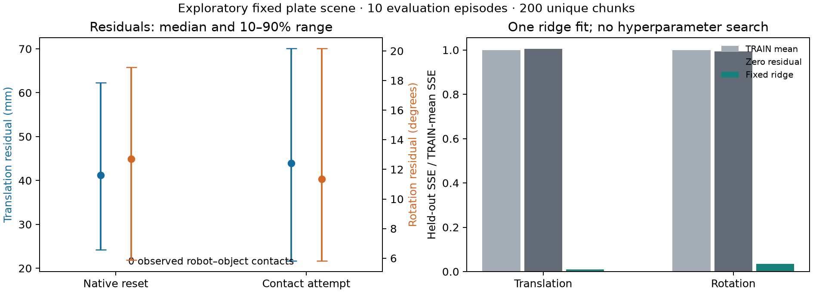
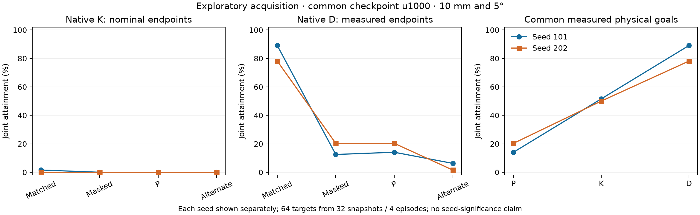
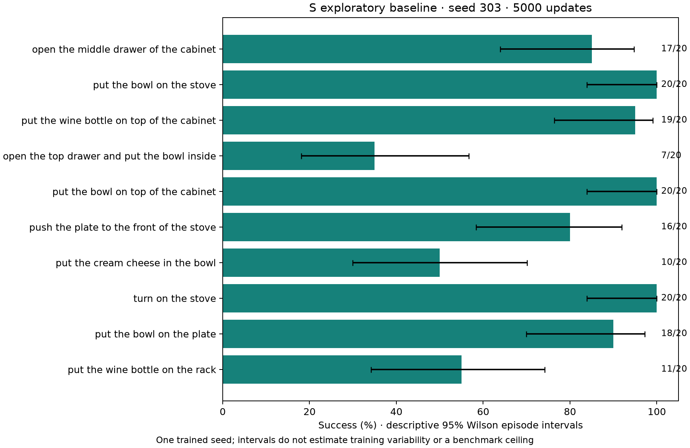

# Preliminary execution report

Repository: https://github.com/imadken/can-llms-learn-physical-data.git
Local branch: `research/effect-pretraining-stage1-v2`. The repository is public; no branch was pushed or public release made.
The bundle's delivery.json binds the exact final implementation/results commits without a self-referential commit hash.
Execution revisions: `{"S": "5f9ec82f4fa4c215a0633bc3a594029d5294aa21", "acquisition": ["4dcce17ba52d99a8825a7561321949d4c4b53d86"], "collection": "7cdd9f06a8db8e486e62f611a8ad58814287f50e", "residual_replays": "ccb3289da88307170c8cba99d8b40ed8b55fec01"}`.
The persistent interpreter loaded `4dcce17ba52d99a8825a7561321949d4c4b53d86`. S metadata also records HEAD at its initialization; the scientific core is unchanged. Exact historical execution source archives are included in the bundle. The later internal reserve guard is not retroactive; the owned-process watchdog covers this run.

| Preliminary | Status | Actual scope |
| --- | --- | --- |
| 1. Residuals | complete | 100 attempts; 20,000 retained transitions; 100 snapshots; 400 replays |
| 2. Acquisition | complete | P/K/D, seeds 101/202; common checkpoint 1000 |
| 3. S baseline | complete | 5000 updates; 200 task rollouts |

## Residual characterization

All 100 fixed collection attempts completed, with the frozen 80/10/10 episode split. The 14,800 complete TRAIN windows alone fit the effect transform and ridge features. The 1,000 warm-up and 4,000 contact-setup actions are excluded from training windows. There were zero invalid collection attempts and zero failed fixed replays. Collection timing includes the user-requested storage-cleanup pause before accelerator profiling.

No recorded robot–movable-object contact occurred in the 20,000 retained transitions or fixed replays. The contact flag covers movable scene objects; fixture/table and self contacts are outside that flag. The contact stratum is empty. The prescribed collector was not retried or tuned.

| Channel | Mean | Descriptive 95% episode-mean t interval | Ridge RMSE | TRAIN-mean RMSE | SSE reduction |
| --- | ---: | --- | ---: | ---: | ---: |
| translation (mm) | 44.1352 | [41.0840, 47.1864] | 4.5968 | 47.1098 | 99.048% |
| rotation (degrees) | 12.5389 | [11.9710, 13.1067] | 2.5486 | 13.5987 | 96.488% |

All 200 duplicate pairs were bit-identical in full integration state. The 400 replay records represent 200 unique chunks from ten source episodes. Intervals concern this fixed scene's episode means; they do not measure training variability. Predictable discrepancy does not identify controller calibration as its cause, acquisition, downstream utility or equivalence.

## Acquisition

**K: acquisition not demonstrated within this pilot budget** (nominal endpoint space).

| Seed | Mode | Joint attainment | Translation error (mm) | Rotation error (degrees) |
| --- | --- | ---: | ---: | ---: |
| 101 | matched | 1.562% | 25.8026 | 10.8369 |
| 101 | masked | 0.000% | 59.9732 | 19.0944 |
| 101 | alternate | 0.000% | 84.1734 | 25.9081 |
| 101 | P | 0.000% | 62.2741 | 19.6993 |
| 202 | matched | 0.000% | 23.6279 | 10.8373 |
| 202 | masked | 0.000% | 57.3023 | 19.2617 |
| 202 | alternate | 0.000% | 84.2263 | 26.1497 |
| 202 | P | 0.000% | 58.7099 | 19.6690 |

**D: positive exploratory acquisition evidence** (physical endpoint space).

| Seed | Mode | Joint attainment | Translation error (mm) | Rotation error (degrees) |
| --- | --- | ---: | ---: | ---: |
| 101 | matched | 89.062% | 6.7619 | 2.7454 |
| 101 | masked | 12.500% | 13.9410 | 4.4553 |
| 101 | alternate | 6.250% | 18.0315 | 5.9095 |
| 101 | P | 14.062% | 14.4705 | 4.4956 |
| 202 | matched | 78.125% | 6.9453 | 2.6092 |
| 202 | masked | 20.312% | 13.2809 | 4.4407 |
| 202 | alternate | 1.562% | 18.8521 | 5.9714 |
| 202 | P | 20.312% | 13.4992 | 4.5438 |

K's native score is analytic nominal attainment. The separate common physical-goal scores are shown below. Each seed has 64 targets from 32 snapshots drawn from four episodes. P/masked outputs and paired goal outputs are reused for scoring; these are not independent samples. Two training seeds support descriptive results, not equivalence or training-seed significance.

| Seed | Arm | Common physical joint attainment | Translation error (mm) | Rotation error (degrees) |
| --- | --- | ---: | ---: | ---: |
| 101 | P | 14.062% | 14.4705 | 4.4956 |
| 101 | K | 51.562% | 9.7611 | 3.0655 |
| 101 | D | 89.062% | 6.7619 | 2.7454 |
| 202 | P | 20.312% | 13.4992 | 4.5438 |
| 202 | K | 50.000% | 9.7036 | 3.4053 |
| 202 | D | 78.125% | 6.9453 | 2.6092 |

Generated 576 unique chunks; 448 whole physical chunk replays. All materialized generated actions and replay states passed finite-value checks. No target or result was excluded based on attainment. Physical goals outside the nominal TRAIN coordinate range: 0.0%. Nearly coincident goal pairs (within 10 mm and 5 degrees): 2/32.

## Standard baseline

| Task | Successes / valid episodes | Invalid episodes | Descriptive 95% Wilson interval |
| --- | ---: | ---: | --- |
| open_the_middle_drawer_of_the_cabinet | 17/20 | 0 | [63.96%, 94.76%] |
| put_the_bowl_on_the_stove | 20/20 | 0 | [83.89%, 100.00%] |
| put_the_wine_bottle_on_top_of_the_cabinet | 19/20 | 0 | [76.39%, 99.11%] |
| open_the_top_drawer_and_put_the_bowl_inside | 7/20 | 0 | [18.12%, 56.71%] |
| put_the_bowl_on_top_of_the_cabinet | 20/20 | 0 | [83.89%, 100.00%] |
| push_the_plate_to_the_front_of_the_stove | 16/20 | 0 | [58.40%, 91.93%] |
| put_the_cream_cheese_in_the_bowl | 10/20 | 0 | [29.93%, 70.07%] |
| turn_on_the_stove | 20/20 | 0 | [83.89%, 100.00%] |
| put_the_bowl_on_the_plate | 18/20 | 0 | [69.90%, 97.21%] |
| put_the_wine_bottle_on_the_rack | 11/20 | 0 | [34.21%, 74.18%] |

Pooled successes: 158/200. Equal-task mean: 79.00%; descriptive pooled 95% Wilson interval: [72.84%, 84.07%]. 0 scheduled episodes were unperformed. Invalid attempts are retained with reasons in baseline_episodes.csv and excluded from valid-episode success denominators; there are no replacements. One trained seed does not estimate training variability or a benchmark ceiling. Demonstration/reset disjointness is not established, so this is an exploratory diagnostic rather than an independent leaderboard claim.

## Correctness and provenance

Hardware: 10 Cortex-X925 plus 10 Cortex-A725 cores, NVIDIA GB10, driver 580.159.03. Python 3.11.15; Torch 2.10.0+cu130; Transformers 4.57.3; MuJoCo 3.3.7; robosuite 1.4.1. Official LIBERO revision `8f1084e3132a39270c3a13ebe37270a43ece2a01`; SmolVLA revision `5e8d12a6e2975b0e5e5fce7c8caf47c371d257b6`. Full dependency paths and source hashes are in resolved_environment.json.

The exact 2.2 scientific release remains hash-verified. Native mapping/inverse transforms, serialized full-state replay, padding/flow sign, projector gradients through the frozen decoder, masked-effect invariance, frozen hashes, transfer cleanup and paired streams are checked. Actual checkpoint master parameters and Adam moments are FP32 under BF16 autocast.

Both projectors used 512 distinct evenly spaced TRAIN windows. State RMS was 0.219354522; absorbed alpha was 1.980329311 (seed 101) and 1.969732337 (seed 202). K and D share nominal-TRAIN means/scales with 1 mm/1 degree floors. P receives transformed zero. No evaluation/demonstration data fit those constants.

The ten official raw demonstration files are revision/hash pinned. Each task has ten selected training and five separate held-out validation trajectories (100 TRAIN and 50 held-out trajectories total). Source-verified post-action observations are paired with the following action chunk, excluding one extra terminal candidate window per selected trajectory. Native camera rotation and processing are preserved. No validation-based checkpoint selection occurs.

Command provenance limitation: 9 early engineering diagnostics retained argv/environment/revision/output but omitted inline stdin source. Their byte-exact input is unavailable; command_provenance.json identifies them. Production collection, replay, profiling and training use recorded module commands and versioned source. Subsequent inline inputs are retained and hashed.

Early CUDA context failures occurred before update 0. The user performed the approved one-time cache flush/compaction after sudo required a local password. The original failures and both measured image microbatches are retained. A persistent CUDA context and an owned-process hard-limit guard preserve the original ceilings. No other job was terminated or shared software upgraded.

## Budget and artifacts

Accelerator reservation time used: 14940.988 seconds (4.15027 hours), ceiling 8 hours. Execution wall time since profiling: 17626.086 seconds, ceiling 12 hours. The calendar cutoff remains 28 November 2026 at 18:00 Europe/Paris.

| Profile | Microbatch / accumulation | Mean update seconds | Peak allocated GiB |
| --- | --- | ---: | ---: |
| numerical | 16 / 8 | 0.399992 | 2.8579 |
| multimodal | 8 / 4 | 1.009435 | 3.8999 |

Maximum production fit allocation recorded: 3.8934 GiB.
The ledger counts the full persistent accelerator reservation, including CPU replay between phases, without double-counting nested phases. Both image microbatch profiles and zero-update platform faults are retained and charged. Timing and phase-level details are in accelerator_jobs.jsonl and accelerator_phases.jsonl.

Campaign running at report time: False. Full local artifacts: `/home/imad/Desktop/repos/can-llms-learn-physical-data/artifacts/stage1-v2-20261121`. Datasets, full snapshots, model/optimizer checkpoints and caches are outside Git. The compressed review bundle includes five pre-existing replay examples and a SHA256 manifest of all retained full artifacts. Its SHA256 is in an external checksum file; delivery.json supplies revisions.

The public repository was not pushed. The user's unrelated .gitignore edit, original source ZIP and PGX documentation are preserved. No Stage 2 campaign, optional extension, manuscript conclusion change, public release or scheduled continuation was performed.
